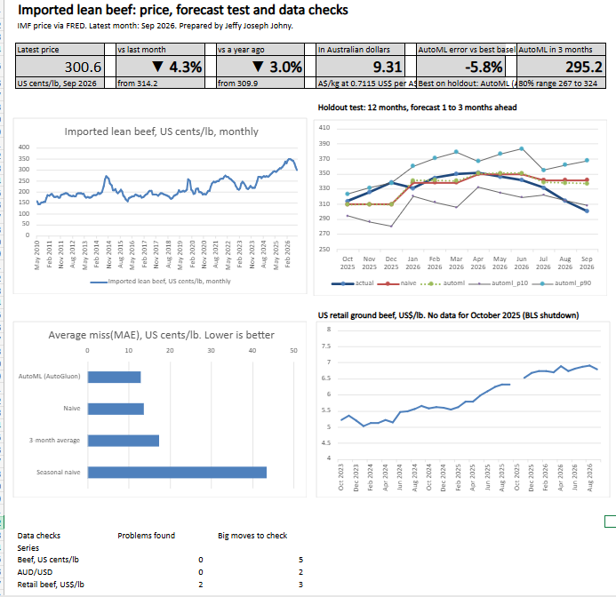

# Imported lean beef: data checks, baseline vs AutoML, Excel dashboard

A small market analysis project on the price of imported frozen lean beef, the raw material for US ground beef. It covers the whole workflow of a junior data and market analyst: checking public data, testing an AutoML forecast against simple baselines on a later holdout period, building an Excel dashboard that recomputes the Python results, and writing a short market note backed by checked sources.



## The question

Over the last 12 months, could AutoML forecast the imported lean beef price 3 months ahead better than simple baselines?

## The answer

**Yes, but only just.** AutoGluon missed by 12.94 US cents/lb on average, against 13.73 for the naive forecast (repeat the last known price): about 6% better. Its forecasts stayed close to naive, and neither method caught the sharp fall in August and September 2026. With only 12 holdout months, this is a small gain, not proof.

## Key numbers (September 2026)

| Measure | Value |
|---|---|
| IMF beef price | 300.6 US cents/lb |
| Change vs August 2026 | −4.3% |
| Change vs September 2025 | −3.0% |
| Change since May 2026 | −13.2% (four monthly falls in a row) |
| 12-month range | 300.6 to 351.4 (peak in April 2026) |
| Same price in other units | US$6.63/kg, or A$9.31/kg at 0.7115 US$ per A$ |
| US retail ground beef (100%) | US$6.79/lb |

## Data

| Series | What it is | Unit | Source |
|---|---|---|---|
| [PBEEFUSDM](https://fred.stlouisfed.org/series/PBEEFUSDM) | IMF global price of beef: Australian and New Zealand frozen boneless lean beef, US import price | US cents/lb | IMF, via FRED |
| [EXUSAL](https://fred.stlouisfed.org/series/EXUSAL) | Australian dollar exchange rate, monthly average | US$ per A$ | Federal Reserve, via FRED |
| [APU0000703112](https://fred.stlouisfed.org/series/APU0000703112) | US average retail price of 100% ground beef | US$/lb | BLS, via FRED |

- Period used: May 2010 to September 2026 (197 months).
- Downloaded: [date]. The IMF series was last updated on FRED on 22 October 2026, the retail series on 10 November 2026.
- The raw CSV files are not in this repository, because FRED marks the IMF series as copyrighted. [data/README.md](data/README.md) explains how to download them, the exact version I used, and how to check you have the same files.

## What I did

1. **Loaded** each file as text and parsed dates with one exact format (`YYYY-MM-DD`). Blanks became missing values, never zeros.
2. **Checked** each series for unparsed dates, duplicate months, dates not on the first of the month, missing months, blank values, values outside a plausible range, and monthly moves above 10%.
3. **Cleaned** the data onto one monthly calendar and added unit conversions as new columns: US$/kg (÷100 × 2.20462) and A$/kg (÷ AUD/USD). The original price column is unchanged.
4. **Held out** the last 12 months, October 2025 to September 2026. Made forecasts from four start months (October 2025, January, April and July 2026), each 1 to 3 months ahead, so every holdout month is forecast once.
5. **Compared** three baselines (naive, seasonal naive, 3-month average) with AutoGluon `TimeSeriesPredictor` (`medium_quality` preset, 10-minute limit, seed 42) on MAE, MAPE, bias and MASE. The AutoML models were trained only on data before October 2025 and not refit.
6. **Logged** every run (data fingerprints, periods, settings, library versions) in `outputs/experiment_log.csv`.
7. **Rebuilt** the three baselines and all four MAEs with Excel formulas. They match Python within 0.01 (Calc sheet).
8. **Checked AI research.** I asked two AI tools for drivers of the price fall, then checked 21 of their claims against the original sources (Sources sheet).
9. **Wrote** a short market note: [market_note.md](market_note.md).

## Results

### Data checks

| Series | Problems found | Moves above 10% |
|---|---|---|
| Beef, US cents/lb | 0 | 5 |
| AUD/USD | 0 | 2 |
| Retail ground beef, US$/lb | 2 missing months | 3 |

The two missing retail months are left blank, not filled:

- **October 2025:** BLS did not collect prices during the US government shutdown.
- **October 2012:** missing in the source, and the source gives no reason.

### Holdout test (October 2025 to September 2026)

| Method | MAE (US cents/lb) |
|---|---|
| AutoML (AutoGluon) | 12.94 |
| Naive | 13.73 |
| 3-month average | [from the Metrics sheet] |
| Seasonal naive | 43.38 |

- **AutoML range:** the 10–90% range held the actual price in 9 of 12 months (target about 80%). The actual price was above the range in December 2025, and below it in August and September 2026.
- **Seasonal naive** did badly because prices rose over the year, so the price from 12 months earlier was far too low.

### Next 3 months

The AutoML central forecast for December 2026 is 295.2 US cents/lb. Its 80% range for October to December 2026 is 266.6 to 323.9. Given the holdout result, I would report the range, not the point.

### AI research check

Of 21 claims checked, 10 matched the original source in the first pass, 3 conflicted between sources, 1 was not in the source, and 5 are still to check. Examples:

- One tool described the IMF price as "85% chemical lean". The IMF specification says "85 percent visible lean".
- IMF documents describe the price basis as FOB in one place and CIF in another.
- Two news reports of the same MLA export forecast gave 1.606 and 1.646 million tonnes.

## Repository structure

```text
beef-price-forecast/
├── README.md
├── beef_price_forecast.ipynb        Colab notebook, with outputs
├── market_note.md                   One-page market note
├── data/
│   └── README.md                    Where to download the data, and known issues
└── outputs/
    ├── beef_market_dashboard.xlsx   Dashboard, Calc, Notes, Sources and data sheets
    ├── experiment_log.csv           One row per method per run
    ├── holdout_chart.png
    └── dashboard.png
```

## How to reproduce

1. Download the three CSV files as described in [data/README.md](data/README.md). Do not open and re-save them in Excel, because it can change the date format.
2. Open `beef_price_forecast.ipynb` in [Google Colab](https://colab.research.google.com) and upload the three files to the Files panel.
3. Run Step 0 to install AutoGluon, then restart the session and run the check cell. pip may print a red dependency message about torchvision. That is expected, and the cell removes torchvision, which AutoGluon does not use.
4. Run the remaining cells from top to bottom. Step 11 downloads the Excel workbook, the log and the chart.
5. To refresh the dashboard, paste the new Data, Metrics, Checks and Outlook sheets, and columns A to J of the Forecast sheet, into `beef_market_dashboard.xlsx`. The dashboard formulas find the latest month by themselves.

## Limits

- One price series, with no outside drivers in the model.
- 12 holdout months is a small test.
- The AutoML models were not retrained on the holdout months before the 3-month outlook.
- The data starts in May 2010. A longer history may change the result.

## Next steps

- Add drivers as model inputs: lagged AUD/USD, US beef import volumes, US cow slaughter, and US quota fill.
- Retrain at each forecast start month and test more start months.
- Rerun with the full price history and with weekly USDA data.

## How I used AI

An AI assistant helped me draft the notebook code and plan the steps. I ran every step on the real data, read each output, and rebuilt the key results in Excel to check them. For the market note, I asked two AI tools for possible drivers, used AI to locate the original sources, and checked each figure against them. The Sources sheet shows which claims matched and which did not.

## Author

Jeffy Joseph Johny · [GitHub](https://github.com/jeffyjohny7) · [LinkedIn](https://linkedin.com/in/jeffy-joseph-johny-730428174)
